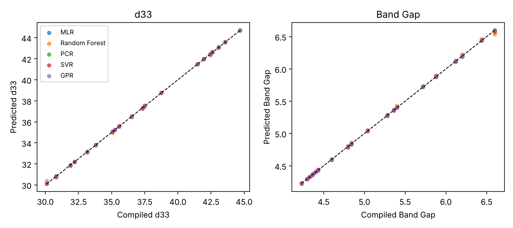

# Machine Learning for Scandium Composition Effects in AlScN Thin Films

Comparing five regression models (MLR, Random Forest, PCR, SVR, Gaussian Process) for predicting the **piezoelectric coefficient d33** and **band gap** of aluminum scandium nitride (Al<sub>1-x</sub>Sc<sub>x</sub>N) as a function of scandium content. Master's project at the University at Buffalo (Department of Materials Design and Innovation), presented at the Materials Science and Technology (MS&T) technical meeting, July 2023.



## Why AlScN

Adding Sc to AlN raises its piezoelectric response and can make it ferroelectric, while staying CMOS compatible. That makes it attractive for MEMS sensors, actuators and non-volatile memory. The question here is how strongly Sc content drives d33 and the band gap, and which simple models capture that trend.

## Dataset

`data/AlScN_Dataset.xlsx` has 100 rows, one per 1% Sc (1 to 100%), with: Al composition, d33, second harmonic generation, dielectric loss tangent, power consumption, coercive field, lattice constant, bond length, photoelasticity and band gap.

The values were compiled from published studies. Because the table is on a regular 1% grid and every property changes smoothly with Sc, intermediate compositions are not individually measured data points. Treat the table as a compiled trend.

## Results

Test RMSE (R² in brackets). d33 is in the dataset's units, band gap in eV. Inputs are all composition-linked properties; numbers come from `notebooks/alscn_ml_composition_property.ipynb`.

| Model | d33, random split | Band gap, random split | d33, extrapolation (Sc > 70%) | Band gap, extrapolation |
|---|---|---|---|---|
| MLR | 0.005 (1.00) | 0.004 (1.00) | 0.112 (0.994) | 0.082 (0.15) |
| PCR | 0.021 (1.00) | 0.005 (1.00) | **0.089 (0.996)** | **0.015 (0.97)** |
| Random Forest | 0.091 (1.00) | 0.019 (0.999) | 2.969 (-3.27) | 0.185 (-3.30) |
| SVR | 0.010 (1.00) | 0.008 (1.00) | 4.964 (-10.9) | 0.694 (-59.4) |
| Gaussian Process | 0.000 (1.00) | 0.001 (1.00) | 0.112 (0.994) | 0.249 (-6.81) |

**What this shows:**
- On a random split every model is almost perfect. This is expected, because the data is smooth and neighboring compositions are in both train and test sets, so these scores say little about new materials.
- Extrapolating to higher Sc separates the models. Linear and projection methods (MLR, PCR) hold up for d33, and PCR is best for band gap. Tree-based and kernel models fail outside the training range.
- Sc content alone is nearly enough to predict both targets, since the other inputs are themselves functions of Sc.

## Repository structure

```
.
├── data/AlScN_Dataset.xlsx
├── notebooks/alscn_ml_composition_property.ipynb
├── figures/
├── results_summary.csv
├── requirements.txt
└── LICENSE
```

## Getting started

```bash
git clone https://github.com/AnandTumuluri/alscn-composition-property-ml.git
cd alscn-composition-property-ml
pip install -r requirements.txt
jupyter notebook notebooks/alscn_ml_composition_property.ipynb
```

## Limitations and future work

- Compiled, smoothly varying data: results show how well models reproduce a trend, not prediction of new measurements.
- Inputs such as lattice constant and bond length are strongly tied to Sc content, so the models have limited independent information.
- Next steps: collect individually measured films with thickness and growth conditions, add the ferroelectric switching data (coercive field, polarization versus field), and use grouped cross-validation by source paper.

## Note on the original analysis

This notebook is a clean reimplementation of the project's model comparison (MLR, Random Forest, PCR, SVR, Gaussian Process, scored by RMSE). The original analysis code was not preserved, so exact numbers from the 2023 presentation may differ.

## Author

Poornanand Tumuluri, University at Buffalo. Faculty advisors: Baishakhi Mazumder and Jung-Hun Seo.

## License

MIT
